<picture>
  <source media="(prefers-color-scheme: dark)" srcset="./dark.svg">
  <source media="(prefers-color-scheme: light)" srcset="./light.svg">
  
</picture>

 

  
  
  
  

---

## 🚀 About Me

Hi there! 👋 I'm Jesmin Sheladiya, a passionate Software Developer from India 🇮🇳.

💻 I enjoy building modern, responsive, and user-friendly web applications with clean design and efficient functionality.

🌱 I'm continuously learning new technologies, improving my development skills, and exploring creative solutions to real-world problems.

🛠️ I work with HTML, CSS, JavaScript, React.js, Next.js, Java, Firebase, and PostgreSQL, along with various development tools.

🚀 I love turning ideas into meaningful digital experiences and exploring opportunities to grow as a developer.

### 📬 Contact Me

- 📫 Email: **jesminsheladiya1832@gmail.com**  
- 🔗 LinkedIn: https://www.linkedin.com/in/jesmin-sheladiya

---

## 🛠 Tech Stack

<!-- TABLE 1 -->
| **Languages & Core** | **Frameworks & Libraries** | **Backend & BaaS** |
|----------------------|----------------------------|-----------------|
|  HTML5 |  React.js |  Java |
|  CSS3 |  Next.js |  Firebase (BaaS) |
|  JavaScript |  Bootstrap | |
|  jQuery |  Three.js | |

 

<!-- TABLE 2 -->
| **Database & Management** | **DevOps & Deployment** | **CMS & Automation** | **API & Testing** |
|:---|:---|:---|:---|
|  PostgreSQL |  GitHub |  WordPress |  Postman |
| phpMyAdmin |  Vercel | n8n | |

---

## 📂 Featured Projects

<table align="center" width="100%">
  <tr>
    <td align="center" width="50%">
      
    </td>
    <td align="center" width="50%">
      
    </td>
  </tr>
  <tr>
    <td align="center" width="50%">
      
    </td>
    <td align="center" width="50%">
      
    </td>
  </tr>
</table>

---

## 📊 GitHub Stats

<table align="center" width="100%">
  <tr>
    <td align="center" width="50%">
      
    </td>
    <td align="center" width="50%">
      
    </td>
  </tr>
</table>

---
